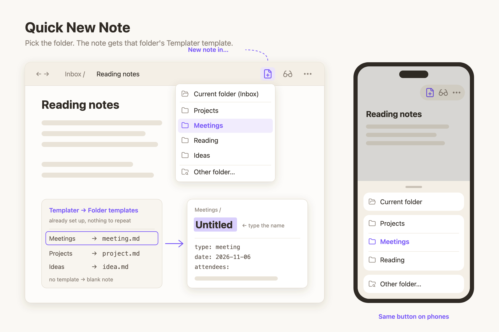

# Quick New Note

Obsidian puts every new note in one default folder. If your notes live in
several folders, you create the note, then move it, every single time.

Quick New Note puts a **New note in…** button in the note header. Click it and
you get a menu of *your* folders, in *your* order. Pick one and a new note is
created right there, opened, with the title selected so you can type its name.

If you use [Templater](https://github.com/SilentVoid13/Templater) folder
templates, the new note gets the template set for that folder. There is
nothing to set up twice.

## Features

- **Your own list of folders.** Add them in settings, reorder them with the
  up/down arrows, and give long paths a short alias (`Areas/Work/Meetings` →
  `Meetings`).
- **Current folder** at the top of the menu: a new note next to the one you are
  reading, in one click.
- **Other folder…** at the bottom searches every folder in the vault. It
  doesn't depend on the core *Files* plugin, so it still works if you use
  another file explorer.
- **Templates come from Templater.** The note gets the template from
  Templater → *Folder templates* for its folder, or for the nearest parent
  folder that has one, so subfolders inherit it. Templater syntax (`<% %>`)
  runs as usual. Folders without a template get a blank note.
- **Opens like Obsidian's own new note**: in the current tab, in editing mode,
  with the title selected. Cmd/Ctrl-click opens it in a new tab, or turn on
  *Always open in a new tab*.
- **Never overwrites.** Names follow Obsidian's pattern: `Untitled`,
  `Untitled 1`, `Untitled 2`…
- **Rename a folder** in the vault and the list follows it.
- **Works on phones and tablets.** The same button sits in the mobile header
  and the menu opens as a bottom sheet. There is also a ribbon icon and a
  command, **Quick New Note: Open new note menu**, for a hotkey or the mobile
  toolbar.
- **Already using Quick Move?** One button in settings imports its folder list.
- English and Chinese interface, following Obsidian's language.

## How templates are chosen

| Templater installed? | Folder has a Templater folder template? | New note |
|---|---|---|
| Yes | Yes (or a parent folder has one) | That template, with Templater syntax processed |
| Yes | No | Blank |
| No | — | Blank |

Templater's folder templates are read from its settings: set
*Trigger Templater on new file creation* mode to **Folder templates** and add
your folder → template pairs there. Quick New Note uses that table even when
the trigger itself is switched off on a device, so the same button creates the
same note on your phone and your computer.

## Use cases

- Meeting notes straight into `Meetings` with the meeting template, from any note.
- Capture on your phone into the right folder instead of a catch-all inbox.
- Keep a short list of today's active project folders at the top of the menu.

## Install

Search for **Quick New Note** in Settings → Community plugins, or copy
`main.js`, `manifest.json` and `styles.css` from the latest release into
`<vault>/.obsidian/plugins/quick-new-note/`.

Then open Settings → Quick New Note and add your folders.

## License

MIT
